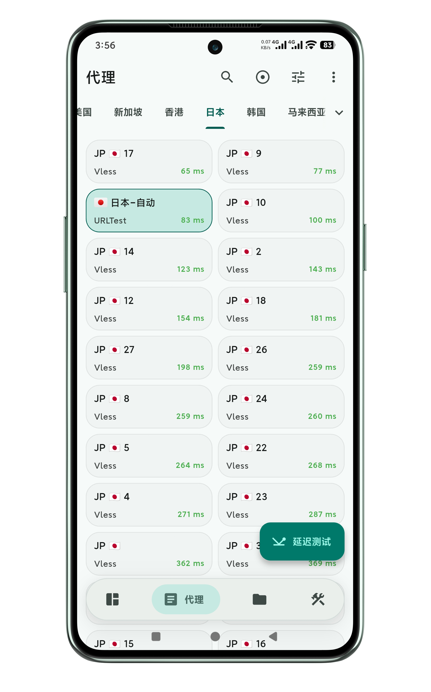
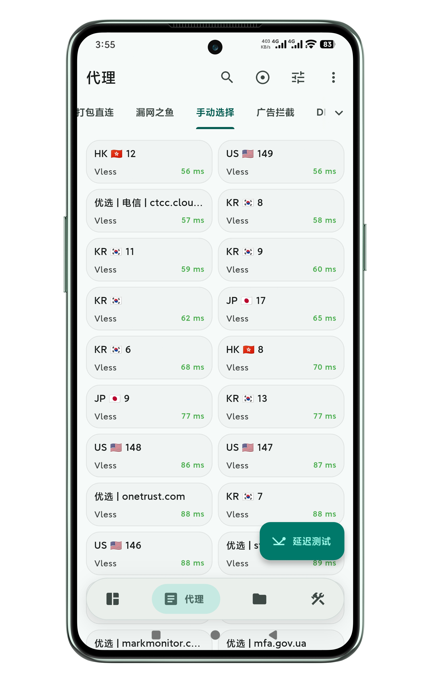
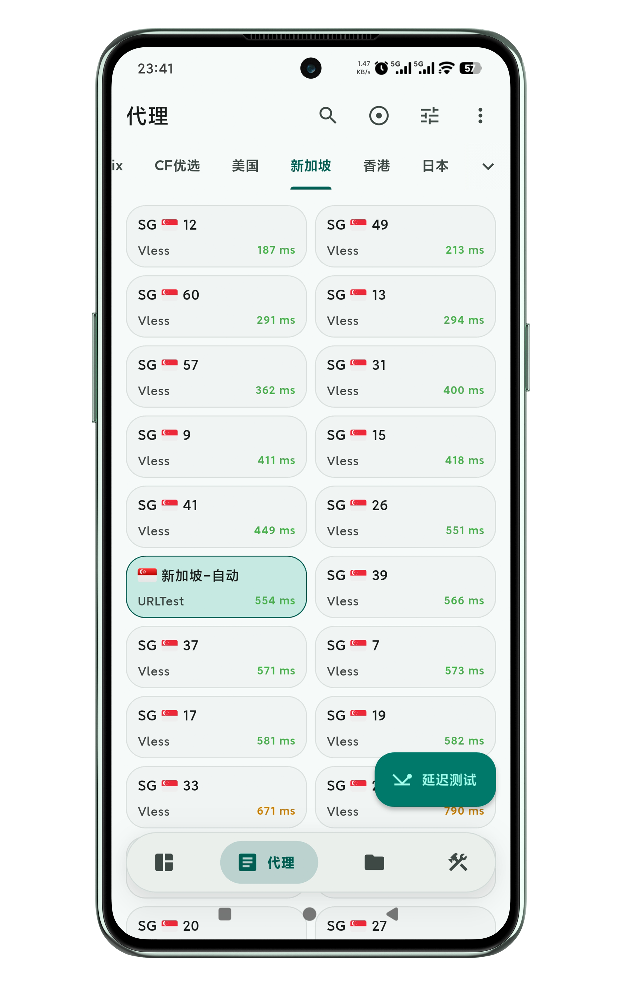
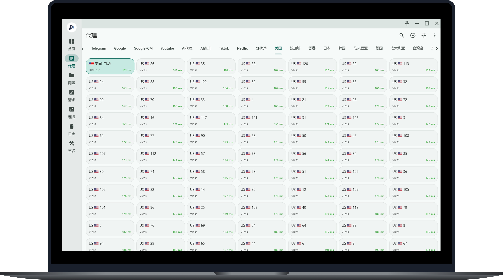
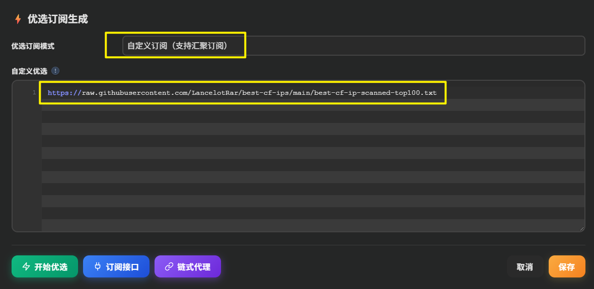

<div align="center">

# Cloudflare 优选IP API（IPV4）

### 提供自动更新的 Cloudflare 优选 IP API，服务于 Cloudflare 免费代理搭建方案，优质 IP 即为优质节点

  <a href="https://t.me/liqunchannel"></a>

</div>

> [!CAUTION]   
> **破坏性更新历史，需尽快更新您的 API 链接**：    
> 2026.10.29  
> - 因上游优选 IP 项目产出不稳定，故取消 **采集聚合优选 IP API**  
>   
> 2026.9.11  
> - 聚合 API 文件名变更为：best-cf-ip-collected.txt   
> - 独立 API 文件名变更为：best-cf-ip-scanned-top**.txt  
>   
> 2026.9.5  
> - 优选域名 API 已迁移至新仓库 [**best-cf-domains**](https://github.com/LancelotRar/best-cf-domains)

> [!NOTE]   
> **中转站邀请注册链接，可白嫖大模型，注册互有奖励**：  
> - ~~https://api.justwoker.icu/register?aff=Sp57~~
> - https://agentrouter.org/register?aff=R6aO
> - https://chat.b.ai/chat?invite_code=65TF6G
> - https://y-api.bestvirtualgoods.com/i/7N5KJG8Y
>  
> **Workbuddy 国际版，注册即得 100 邀请积分和 250 新人积分**
> - https://workbuddy.ai/invite?code=7CQMESPP
>
> **注册 Muse AI，在加入后的 48 小时内通过“设置”兑现我的邀请码（ 1SU6DJ ），我们就能分别获得 10 亿个 Muse 词元**
> - https://muse.ai/join
> - 解决 [“加入等候名单”](https://t.me/liqunchannel/1350)

## 应用效果

- 转换后的优选 IP 将成为代理节点，再经代理客户端解析，节点名称将显示**国家代码**以及**国旗**。点击图片查看清晰大图

<p align="center">
     
</p>

## 项目说明

- 提供 “**电信线路 优选 IP API**”，一次填入，自动更新，**以延迟排序，按数量分档**，满足不同需求。
- 优选 IP API 可接入 [**Cmliu/edgetunnel**](https://github.com/cmliu/edgetunnel)-"自定义订阅汇聚"，和 [**byJoey/cfnew**](https://github.com/byJoey/cfnew) -"优选 IP 来源 URL"，从而将优选 IP 转换为代理节点。建议具备相应项目基础的用户使用
- 建议具备一定 Cloudflare 基础网络知识的用户使用。[**Cloudflare anycast IP 机制**](https://github.com/LancelotRar/best-cf-ips/issues/3#issuecomment-5508271687) ，不同运营商解析出的国家区域**可能不同**
- 为优选 IP 建立**国家区域、旗帜**标识，有助于按国家区域筛选 CF 节点。如使用 Mihomo 代理客户端，可按节点的国家区域建立策略组。并使用 Url-test 策略，仅在该区域内变动节点IP，缓解 CF 节点 IP 变动带来的负面影响。如 Telegram 新账号养号期，节点IP变动频繁、区域位置变动过大，或将引发账号风控。其它代理客户端同理，需自行设置。对其它有IP风控策略的互联网服务，亦有帮助
- [**自用 Mihomo 配置文件模板**](https://github.com/LancelotRar/free-subs/blob/main/src/liqun_example.yaml)（仅模板，非订阅，已预设主流国家区域分组），杜绝 DNS 泄露，可 fork 后自行修改，亦可直接使用
- 如有帮助，请多多star

## 接入指南

<table>
  <thead>
    <tr>
      <th><div align="center">项目</div></th>
      <th><div align="center">操作示意</div></th>
    </tr>
  </thead>
  <tbody>
    <tr>
      <td valign="middle"><strong>Cmliu/edgetunnel</strong><br>1. 复制粘贴 API 链接至“自定义优选”框中（无需点开下方“订阅接口”按钮）<br>2. <strong><ins>支持填入多个 API 链接</ins></strong><br>3. 保存</td>
      <td align="center" valign="middle"></td>
    </tr>
    <tr>
      <td valign="middle"><strong>byJoey/cfnew</strong><br>1. 复制粘贴 API 链接至“优选 IP 来源 URL” 框中<br>2. <strong><ins>仅支持填入单个 API 链接</ins></strong><br>3. 保存</td>
      <td align="center" valign="middle"></td>
    </tr>
  </tbody>
</table>

## API 详情

- 内容示例（**示例内容不要导入任何工具，请使用 API 链接**）

```txt
# 91 best ips collected at 2026-09-11 00:42
104.17.212.191:443#US 🇺🇸
23.175.201.2:8443#HK 🇭🇰
158.180.69.78:443#KR 🇰🇷
45.77.254.160:443#SG 🇸🇬
45.202.247.198:443#MO 🇲🇴
132.145.127.203:2053#JP 🇯🇵
203.69.11.79:443#TW 🇹🇼
···
```
- 更新时间以实际结果为准，在 API 内容**第一行**有明确标注
- **每 6 小时更新，按延迟排序**
- **国家区域、旗帜标注**
- **选任一档即可，多选重复，没有必要**  

---

- best-cf-ip-scanned-top20 包含 20 个优选 IP

```
https://raw.githubusercontent.com/LancelotRar/best-cf-ips/main/best-cf-ip-scanned-top20.txt
```

- best-cf-ip-scanned-top50 包含 50 个优选 IP，向上包含

```
https://raw.githubusercontent.com/LancelotRar/best-cf-ips/main/best-cf-ip-scanned-top50.txt
```

- best-cf-ip-scanned-top100 包含 100 个优选 IP，向上包含

```
https://raw.githubusercontent.com/LancelotRar/best-cf-ips/main/best-cf-ip-scanned-top100.txt
```

- best-cf-ip-scanned-top200 包含 200 个优选 IP，向上包含

```
https://raw.githubusercontent.com/LancelotRar/best-cf-ips/main/best-cf-ip-scanned-top200.txt
```

- best-cf-ip-scanned-top400 包含 400 个优选 IP，向上包含

```
https://raw.githubusercontent.com/LancelotRar/best-cf-ips/main/best-cf-ip-scanned-top400.txt
```

## 相关视频教程

- [Cloudflare 免费节点怎么提速？第二弹：新增2种方法筛选高速优选IP | 4K测速](https://www.youtube.com/watch?v=hdB7QhGprJk)
- [只要3分钟！Cloudflare免费搭建永久节点，如何获取优选｜自动优选IP实测21万！白嫖节点｜一键订阅【豌豆分享】](https://www.youtube.com/watch?v=NOwpLkHPmao)
- [网速直接起飞！5 种 Cloudflare 免费节点优选 IP 提取技巧，从脚本筛选到地区优选，彻底解决节点卡顿与延迟！](https://www.youtube.com/watch?v=hlD4ejZwBks)
- [CloudFlare免费节点优化！5种方法降低延迟，100+节点测速，YouTube轻松跑11万+！](https://www.youtube.com/watch?v=KyqjoRivo2w&t=970s)
- [【免费VPN】最全 Cloudflare 节点提速方法 | 高速优选IP | 支持ChatGPT/Gemini](https://www.youtube.com/watch?v=O6h3CLAUyiE)

## 项目热度

<p align="center">
<a href="https://www.star-history.com/?repos=lancelotrar%2Fbest-cf-ips&type=timeline&legend=top-left">
 <picture>
   <source media="(prefers-color-scheme: dark)" srcset="https://api.star-history.com/chart?repos=lancelotrar/best-cf-ips&type=date&theme=dark&legend=top-left" />
   <source media="(prefers-color-scheme: light)" srcset="https://api.star-history.com/chart?repos=lancelotrar/best-cf-ips&type=date&legend=top-left" />
   
 </picture>
</a>
</p>